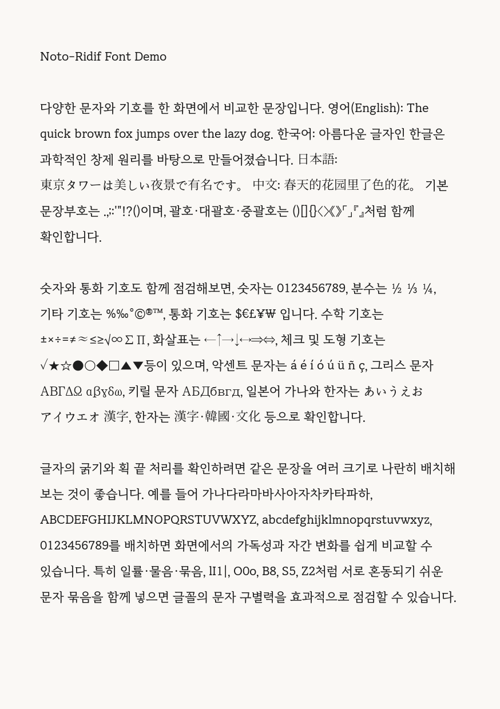

# Noto-ridif

> [!NOTE]
> **리디바탕(RIDIBatang)의 미려한 본문 활자감과 Noto Serif CJK KR의 압도적인 유니코드 글리프 커버리지를 결합한 합성 명조 폰트**



## 📖 서체 소개

**Noto-ridif**는 전자책(E-Book Reader) 및 고해상도 독서 환경에서 널리 사랑받는 **리디바탕(RIDIBatang)**의 유려한 글리프를 기본으로 하고, 누락된 문자나 특수 기호로 인해 발생하는 **Tofu(□, 글자 깨짐)** 현상을 방지하기 위해 **Google Noto Serif CJK KR (본명조)**을 폴백 베이스로 오버레이 병합한 오픈소스 한글 폰트입니다.

### 왜 만들었나요?
- **리디바탕의 뛰어난 가독성**: 긴 문장과 전자책 화면에서 눈의 피로를 덜어주는 특유의 획 구조와 조판 완성도를 제공합니다.
- **Tofu 현상 해결**: 순수 리디바탕 서체에서 지원하지 않는 확장 한자, 특수 부호, 다국어 문자(라틴 확장, 키릴, 그리스 문자 등) 및 수학/도형 기호를 Noto Serif CJK KR의 23,000여 개 글리프로 빈틈없이 채워 넣었습니다.
- **최적화된 글리프 변환**: Cubic(PostScript) 곡선 글리프를 높은 정밀도의 Quadratic(TrueType) 곡선으로 변환하여 임베디드 단말기와 데스크톱 모두에서 빠른 렌더링을 보장합니다.

## ✨ 주요 특징

1. **완벽에 가까운 한글 및 다국어 지원**:
   - 완성형 한글 11,172자 전체 및 한글 호환 자모(ㄱ~ㅎ, ㅏ~ㅣ) 지원
   - CJK 통합 한자 8,138자(KS X 1001 한자 4,620자 포함), 일본어 가나(히라가나/가타카나)
   - 라틴 확장·결합 발음 구별 기호·키릴·베트남어 문자, 문장 부호, 통화 기호($·€·£·¥·₩·₹·₽), 화살표, 수학 연산자
2. **전자종이(E-Paper / E-Reader) 최적화**:
   - 전자책 리더기 단말기에서 바로 사용할 수 있는 바이너리 폰트(`.epdfont`) 변환 스크립트 제공 (1-bit / 2-bit 그레이스케일 지원)
   - 릴리스에 본문용 28px·UI용 20px 2-bit 프리셋 포함
3. **렌더링 및 메트릭 최적화**:
   - 라틴·그리스·키릴·문장부호·숫자 글리프에 TrueType 힌팅 적용 (`--hint`)
   - 세로쓰기 메트릭(`vmtx`) 무결성과 cmap/hmtx 정합성을 빌드 시 검증 (`--verify`)
4. **표준 오픈 TTF 및 웹 폰트**:
   - 모바일, 전자책 뷰어, macOS, Windows, Linux 어디서나 기본 폰트로 즉시 사용 가능
   - EPUB 내부 임베딩·웹용 압축 포맷 `WOFF`(4.2MB)·`WOFF2`(2.5MB) 제공

### 보장 문자 범위

아래 범위는 빌드 시 자동 검증되며, 하나라도 누락되면 `--verify`가 실패합니다.

| 범위 | 내용 |
|---|---|
| U+0020–021F | 라틴 문자 (영문, 숫자, 문장부호, 유럽 언어의 확장 문자) |
| U+0300–036F | 결합용 발음 구별 기호 |
| U+0400–04FF | 키릴 문자 |
| U+1EA0–1EF9 | 베트남어 라틴 확장 (ạ ả ấ ầ) |
| U+2000–2060 | 문장부호 (— … ‘ ’ “ ” † ※ ‰) |
| U+2070–20BF | 위·아래 첨자 (⁰ ⁴ ₀ ₁), 통화 기호 (₩ € ₽) |
| U+2190–21EA | 화살표 (← ↑ → ↓ ↔ ⇒ ⇔) |
| U+2200–22EF | 수학 기호 (∑ √ ∞ ≠ ≤ ≥ ⊂ ∴) |
| U+3000–301F | 한중일 문장부호 (、 。 〈 〉 《 》 「 」 『 』 【 】) |
| U+3131–318E | 한글 호환 자모 (ㄱ~ㅎ, ㅏ~ㅣ) |
| U+4E00–9FFF | 한중일 통합 한자 8,138자 (요구 최소 4,620자) |
| U+AC00–D7A3 | 한글 음절 11,172자 전체 |

Unicode상 미할당·제어·포맷 문자는 검사 대상에서 제외합니다.


## 🛠️ 빠른 시작 (빌드 및 사용법)

이 프로젝트는 [uv](https://github.com/astral-sh/uv) 패키지 매니저를 사용하여 의존성 설치 및 빌드를 간편하게 수행할 수 있습니다.

### 1. 폰트 직접 빌드하기
기본 소스 폰트(`fonts/NotoSerifKR-Regular.ttf` + `fonts/RIDIBatang.otf`)를 병합하여 새로운 `noto-ridif.ttf`를 생성합니다.

```bash
# 의존성 설치
uv sync

# 폰트 병합 실행 (기본 출력: noto-ridif.ttf)
uv run noto-ridif

# 릴리스용 빌드: 힌팅 적용 + 무결성 검증
uv run noto-ridif --hint --verify
```

`--hint`는 `ttfautohint-py` 개발 의존성을 사용하며, 한자·한글 등 CJK 글리프에는 힌팅 명령을 넣지 않고 라틴·그리스·키릴·문장부호·숫자에만 적용합니다.

기본 빌드는 보장 범위를 채우기 위해 `fonts/NotoSerif-Regular.ttf`, `fonts/NotoSansMath-Regular.ttf`, `fonts/NotoSansSymbols2-Regular.ttf`를 자동으로 폴백으로 사용합니다. 다른 폴백을 쓰려면 `--fallback PATH`를 필요한 만큼 반복 지정하세요. 폴백은 베이스·오버레이에 없는 글자만 채웁니다.

### 2. 옵션별 사용자 정의 빌드
```bash
uv run noto-ridif \
  --base fonts/NotoSerifKR-Regular.ttf \
  --overlay fonts/RIDIBatang.otf \
  --output custom-noto-ridif.ttf \
  --name "noto-ridif" \
  --max-err 0.5 \
  --hint --verify
```

## 📜 포함된 유틸리티 스크립트

자세한 옵션과 고급 사용법은 [scripts/README.md](scripts/README.md)를 참고하세요.

### 폰트 데모 렌더러 (`scripts/render_demo.py`)

`noto-ridif.ttf`를 사용하여 실제 A5 규격의 고품질 데모 이미지(`demo.png`)를 생성합니다.

```bash
uv run python scripts/render_demo.py -f demo.txt -o demo.png
```

### E-Paper 바이너리 폰트 변환기 (`scripts/font_to_epdfont.py`)
E-Reader 단말기(Kindle, Kobo, ESP32 기반 전자종이 등)용 초경량 `.epdfont` 파일로 변환합니다.
```bash
# 본문용 28px, 2-bit 그레이스케일
uv run python scripts/font_to_epdfont.py noto-ridif 28 noto-ridif.ttf -o noto-ridif_28_2bit.epdfont

# UI용 20px, 2-bit 그레이스케일
uv run python scripts/font_to_epdfont.py noto-ridif 20 noto-ridif.ttf -o noto-ridif_20_2bit.epdfont

# 전자종이에서 획을 조금 더 진하게 (gamma < 1)
uv run python scripts/font_to_epdfont.py noto-ridif 28 noto-ridif.ttf --gamma 0.85 -o noto-ridif_28_dark.epdfont

# 1-bit 모노크롬 모드 (--1bit)
uv run python scripts/font_to_epdfont.py noto-ridif 20 noto-ridif.ttf --1bit -o noto-ridif_20_1bit.epdfont
```

### 웹 폰트 변환기 (`scripts/font_to_woff.py`)

EPUB 내부 임베딩이나 웹 페이지에서 사용할 수 있는 압축 폰트를 생성합니다. `WOFF2`는 `brotli` 압축을 사용합니다.

```bash
# WOFF + WOFF2 동시 생성
uv run python scripts/font_to_woff.py noto-ridif.ttf --output-dir .

# 한 형식만 생성
uv run python scripts/font_to_woff.py noto-ridif.ttf --formats woff2
```

EPUB에 임베딩할 때는 다음처럼 `@font-face`로 연결할 수 있습니다.

```css
@font-face {
  font-family: "noto-ridif";
  src: url("noto-ridif.woff2") format("woff2"),
       url("noto-ridif.woff") format("woff");
  font-weight: normal;
  font-style: normal;
}
```

### 릴리스 자산 (v0.2.1)

- `noto-ridif.ttf` — 힌팅 및 무결성 검증이 적용된 전체 글리프 폰트
- `noto-ridif.woff` — EPUB·웹용 WOFF 압축 폰트
- `noto-ridif.woff2` — EPUB·웹용 WOFF2 압축 폰트
- `noto-ridif_20_2bit.epdfont` — UI용 2-bit 전자종이 폰트
- `noto-ridif_28_2bit.epdfont` — 본문용 2-bit 전자종이 폰트


## 🧪 테스트 및 품질 검사

코드 스타일, 린트 및 타입 안전성은 프로젝트 내 자동화 도구를 통해 항상 검사됩니다.

```bash
# 테스트 및 린터/타입 일괄 실행
uv run pytest

# Ruff 코드 스타일 검사
uv run ruff check .

# Ty 정적 타입 검사
ty check .
```

## 📄 라이선스 (License)

`noto-ridif` 글꼴 및 파생 폰트 소프트웨어는 [SIL Open Font License 1.1](LICENSE)에 따라 배포됩니다.

- **개인 및 상업적 이용 무료**: 인쇄물, 웹사이트, 영상, 임베디드 기기, 앱 등 모든 상업적/비상업적 용도로 자유롭게 사용할 수 있습니다.
- **수정 및 재배포 허용**: 글꼴을 자유롭게 수정, 가공, 병합 및 재배포할 수 있습니다.
- **제한 사항**: 
  - 본 폰트 소프트웨어 자체를 단독으로 유상 판매할 수 없습니다.
  - 수정되거나 파생된 모든 폰트 역시 동일한 SIL Open Font License 1.1 조건으로 배포되어야 합니다.
- **기반 서체 저작권**:
  - **Noto Serif CJK KR**: © 2017-2024 Adobe (Licensed under SIL OFL 1.1)
  - **Noto Serif (Latin/Greek/Cyrillic)**: © 2022 The Noto Project Authors (Licensed under SIL OFL 1.1)
  - **Noto Sans Math**: © 2022 Google LLC (Licensed under SIL OFL 1.1)
  - **Noto Sans Symbols 2**: © 2022 The Noto Project Authors (Licensed under SIL OFL 1.1)
  - **RIDIBatang (리디바탕)**: © 2019 RIDI Corporation & Sandoll Inc. (Licensed under SIL OFL 1.1)
